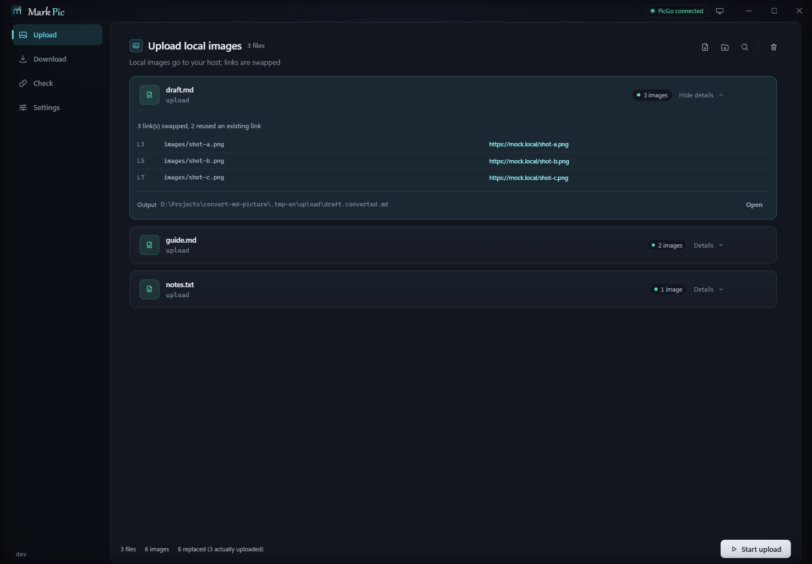
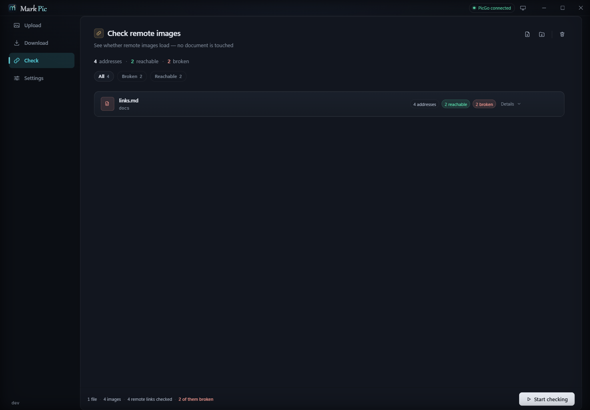
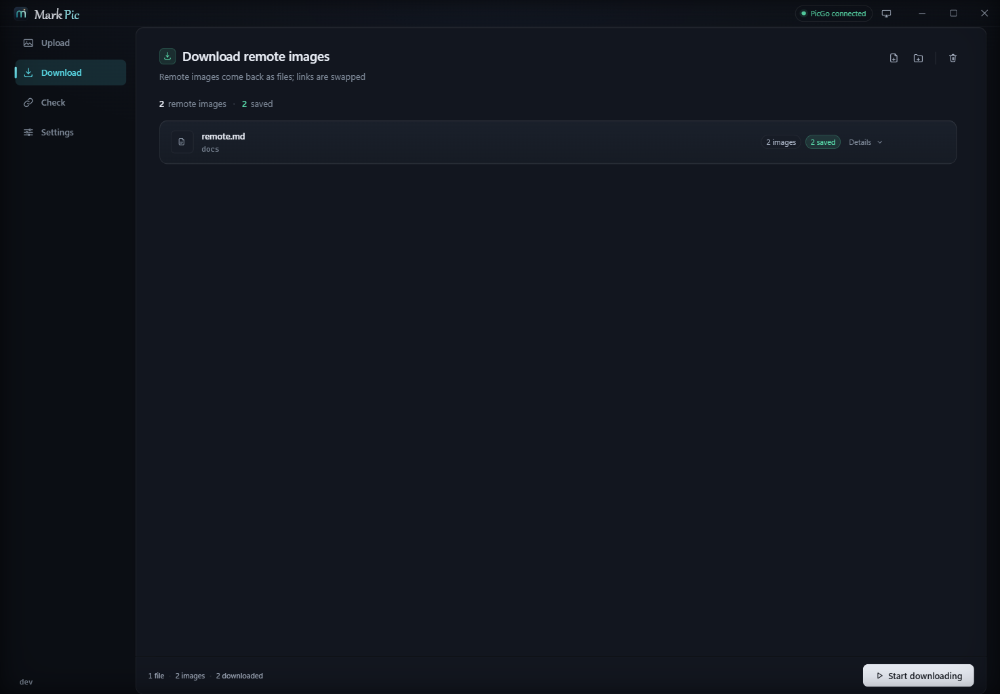
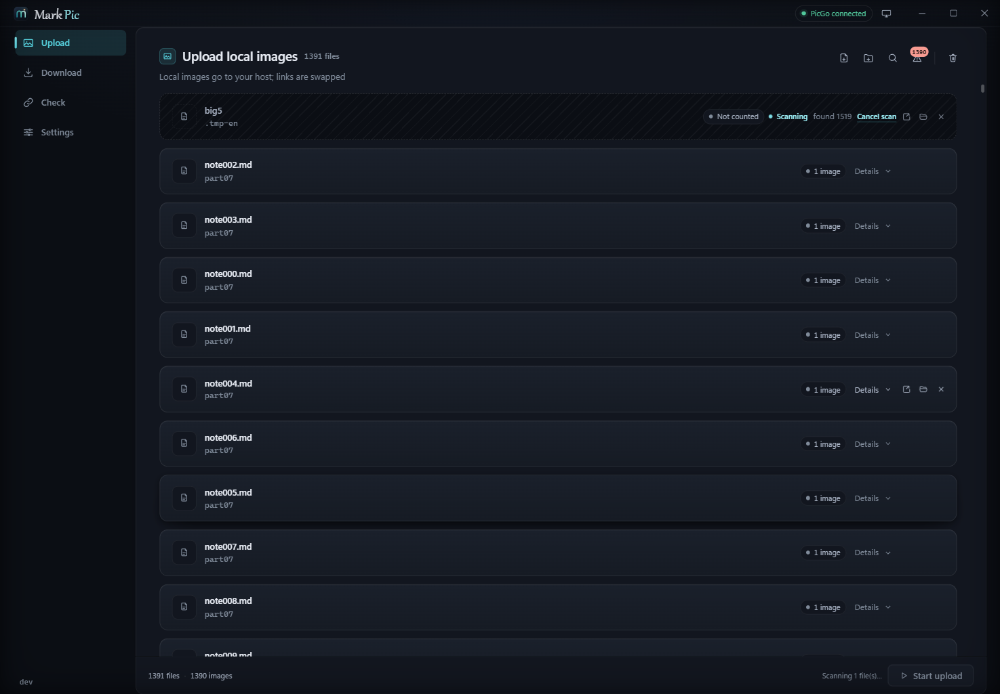
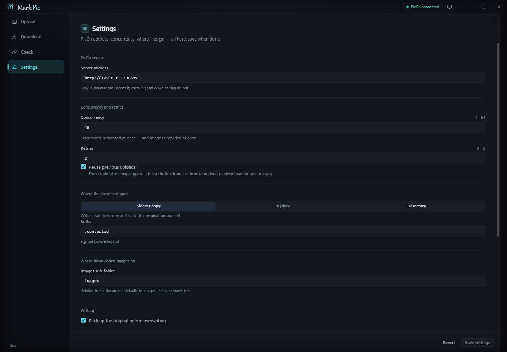

# MarkPic

**The image pipeline for Markdown documents.** Drop a document or a folder, pick one of
three jobs, and MarkPic rewrites the image links — or tells you which ones are broken.

[](https://github.com/geekMus/MarkPic/releases)


[English](README.md) | [简体中文](README.zh-CN.md)



## Three jobs

| Job | What it touches | Rewrites the document | Needs PicGo running |
| --- | --- | --- | --- |
| **Upload** | local images → your image host | yes | yes |
| **Check** | remote image URLs | no | no |
| **Download** | remote images → `images/` | yes | no |

- **Upload** finds the local images a document references, sends them through your
  [PicGo](https://github.com/Molunerfinn/PicGo) server, and rewrites each link to the hosted
  URL. Remote images already in the article are left alone.
- **Check** walks the remote URLs and reports the ones that are dead, are not images, or come
  back truncated. Read-only.
- **Download** pulls those remote images into a local `images/` folder and rewrites the links
  to relative paths.

A document that needs none of this still stops by for a visit — it appears in the queue with
“no images”, so the number of cards always matches the number of documents in the folder.

## What it looks like

### Check: which links are dead



### Download: remote images, brought home



### Big folders: streaming scan you can stop

Dropping a whole drive or a cloud-sync root does not freeze the window. Documents are found
and read while you watch: the folder row counts what has been found so far, cards appear as
they are read, and six thousand files take a couple of seconds instead of a timeout dialog.



Stop at any time — confirm once, keep everything already found, and the row tells you the
rest of that folder was not scanned.

### Settings: everything in one page, saved when you are done



## Features

- **Drop files, several files, or a folder.** A folder is scanned recursively. The extension
  is not what decides: every text file counts (`.md`, `.txt`, `.log`, extension-less
  notes), whether or not it has an image to upload. Images, archives and other binaries are
  skipped.
- **Byte-faithful rewriting.** UTF-8 (with or without BOM), UTF-16 with BOM and the machine's
  ANSI code page all survive the round trip; apart from the rewritten addresses the file comes
  back identical.
- **Never uploads the same image twice.** Identical content is uploaded once per run, and an
  unchanged image that was uploaded or downloaded before is reused from cache.
- **Three output modes.** Sidecar copy (`note.converted.md`), in place (with a `.bak`), or
  into a directory you choose.
- **Desktop manners.** Tray icon, close-to-tray, light/dark theme that follows the system,
  Chinese and English UI, and self-update from GitHub releases.
- **No local server, no runtime, no credentials.** The UI is embedded in the executable;
  uploads go through PicGo's local HTTP interface, so MarkPic never sees your image-host keys.

## Install

Download `MarkPic-v<version>-windows-amd64.exe` from
[Releases](https://github.com/geekMus/MarkPic/releases). There is no installer: put it
anywhere and run it. An installed copy updates itself, and settings plus caches live in the
`data/` folder next to the executable.

Windows 10 or newer. macOS and Linux are planned but not verified yet.

## Quick start

1. Install and start [PicGo](https://github.com/Molunerfinn/PicGo), then enable its server
   under **Settings → Server** (default `http://127.0.0.1:36677`).
2. Drop your documents, or a folder, onto the MarkPic window.
3. Choose **Upload**, **Check** or **Download** on the left, then start.

## Documentation

- [Usage](docs/usage.md) — supported syntax, output modes, settings, data directory
- [Build & development](docs/build.md) — toolchain, scripts, repository layout
- [Bridge API](docs/API.md) — the internal WebView2 bridge between the UI and Go

## Build from source

Requires Go 1.24+. Changing the UI also needs Node 20.19+ and pnpm; the build scripts run
`pnpm --dir web install` for you. One command builds the frontend and produces
`bin/MarkPic.exe`:

```bash
npm run build
```

See [docs/build.md](docs/build.md) for the scripts, the release workflow and the repository
layout.

## License

MIT — see [LICENSE](LICENSE). Bundled third-party code keeps its own license:
[go-webview2](https://github.com/jchv/go-webview2) (MIT) and
[golang.org/x/sys](https://pkg.go.dev/golang.org/x/sys) (BSD-3-Clause).