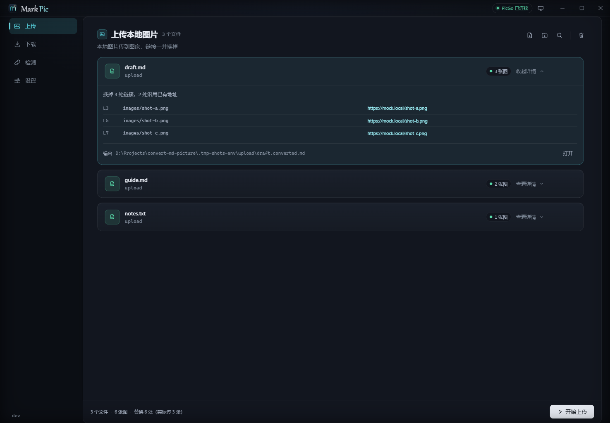
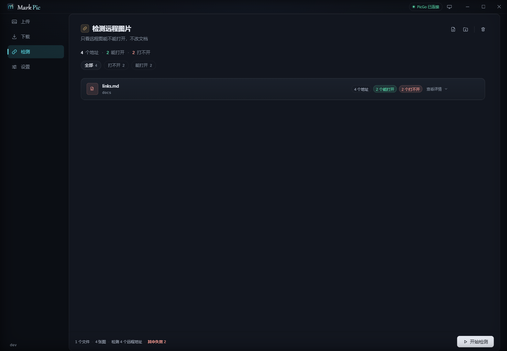
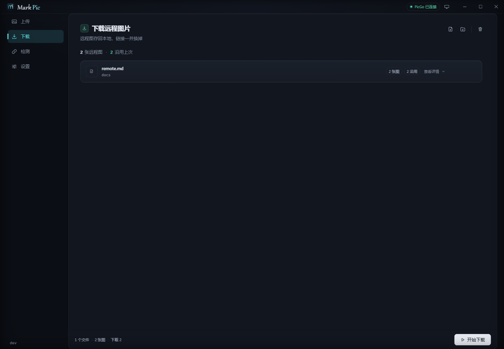
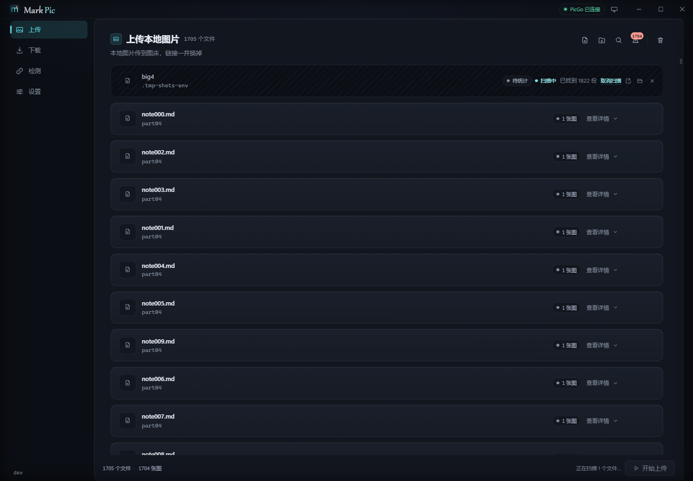
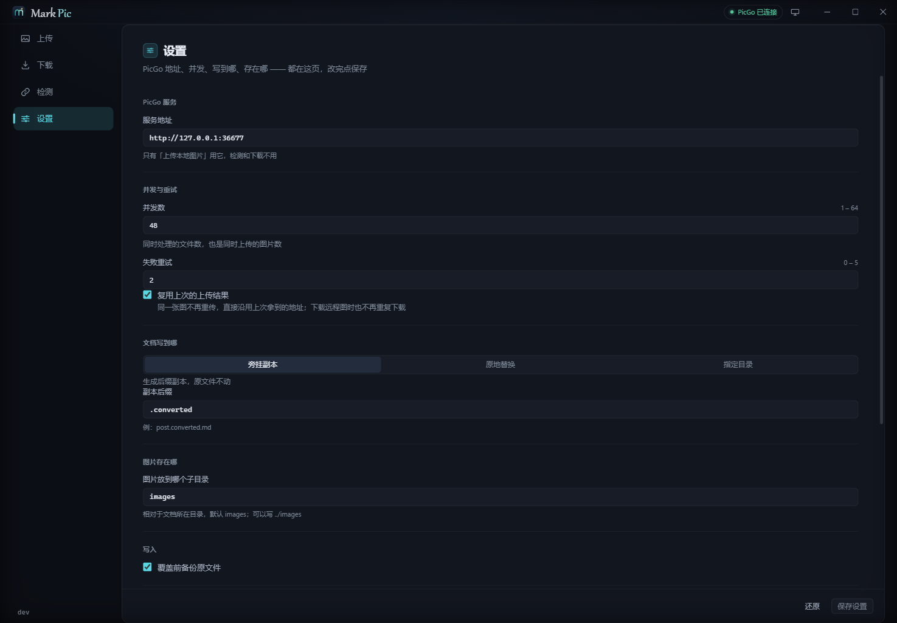

# MarkPic

**Markdown 文档的图片流水线。** 拖进一份文档或一个文件夹，选一种作业，MarkPic 负责把图片
链接换掉 —— 或者告诉你哪几张已经打不开了。

[](https://github.com/geekMus/MarkPic/releases)


[English](README.md) | 简体中文



## 三种作业

| 作业 | 处理什么 | 会改文档吗 | 需要 PicGo 开着 |
| --- | --- | --- | --- |
| **上传** | 本地图片 → 你的图床 | 会 | 是 |
| **检测** | 网络图片地址 | 不会 | 否 |
| **下载** | 网络图片 → `images/` | 会 | 否 |

- **上传**：找出文档引用的本地图片，交给本机的 [PicGo](https://github.com/Molunerfinn/PicGo)
  服务上传，再把每处链接换成图床地址。文章里原有的远程图原样保留。
- **检测**：逐个访问文档里的远程地址，报告打不开、不是图片、只返回半截的那几个。只读。
- **下载**：把这些远程图取回本地 `images/`，链接改成相对路径。

一份「什么都不用做」的文档也会出现在队列里，标着「无图片」—— 这样卡片数永远等于文件夹里的
文档数，不会出现「明明有 3 个只显示 2 个」。

## 界面

### 检测：哪些链接已经失效



### 下载：把远程图取回本地



### 大目录：边扫边出卡片，随时可以停

拖进一整块盘、一个网盘同步目录时界面不会僵住：文档是一边找出来、一边读、一边出现的。
目录那一行显示「已经找到多少份」，卡片随读随加 —— 六千个文件是几秒钟的事，而不是一个
超时对话框。



随时可以停：确认一次，已经扫到的全部留在队列里，那一行也会说清「这个目录剩下的没扫」。

### 设置：一页看完，改完保存



## 特性

- **单文件、多文件、整个文件夹都能拖。** 文件夹会递归扫描；**不是按后缀收文件** ——
  所有文本文件都算文档（`.md`、`.txt`、`.log`、无后缀的笔记），不管它有没有要上传的
  图片。图片、压缩包这类二进制会被跳过。
- **改写保真。** UTF-8（含或不含 BOM）、带 BOM 的 UTF-16、本机 ANSI 代码页都能原样往返；
  除了被替换掉的图片地址，文件一个字节都不变。
- **同一张图不会传两遍。** 内容相同的图片一轮只上行一次；上次传过或下载过、且内容没变的，
  直接从缓存复用。
- **三种输出方式。** 旁挂副本（`note.converted.md`）、原地替换（留 `.bak` 备份）、
  或统一写到你指定的目录。
- **桌面程序该有的样子。** 托盘图标、关闭进托盘、跟随系统的深浅色、中英双语界面，
  以及从 GitHub Releases 自动更新。
- **不起本地服务、不装运行时、不碰密钥。** 界面内嵌在 exe 里；上传只走 PicGo 的本机 HTTP
  接口，MarkPic 看不到你的图床密钥。

## 安装

从 [Releases](https://github.com/geekMus/MarkPic/releases) 下载
`MarkPic-v<版本>-windows-amd64.exe`。没有安装程序：放哪都能跑。已安装的版本会自己更新，
设置与缓存放在 exe 旁边的 `data/` 目录里。

需要 Windows 10 或更新版本。macOS 和 Linux 在计划中，但还没有在真机上验证过。

## 快速开始

1. 安装并启动 [PicGo](https://github.com/Molunerfinn/PicGo)，在 **设置 → 设置 Server** 里
   启用服务（默认 `http://127.0.0.1:36677`）。
2. 把文档或文件夹拖进 MarkPic 窗口。
3. 在左侧选 **上传**、**检测** 或 **下载**，然后开始。

## 文档

- [使用说明](docs/usage.zh-CN.md)：支持的写法、输出方式、设置、数据目录
- [构建与开发](docs/build.zh-CN.md)：工具链、脚本、目录结构
- [Bridge API](docs/API.zh-CN.md)：内嵌界面与 Go 之间的通信接口

## 从源码构建

需要 Go 1.24+。改动界面还需要 Node 20.19+ 和 pnpm（构建脚本会自己执行
`pnpm --dir web install`）。一条命令构建前端并产出 `bin/MarkPic.exe`：

```bash
npm run build
```

脚本、发布流程与目录结构见 [docs/build.zh-CN.md](docs/build.zh-CN.md)。
